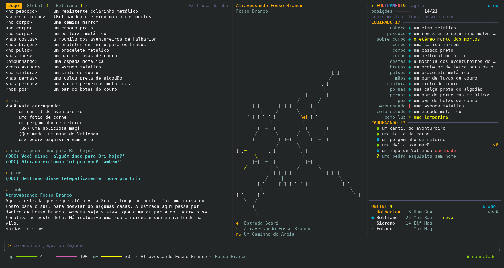
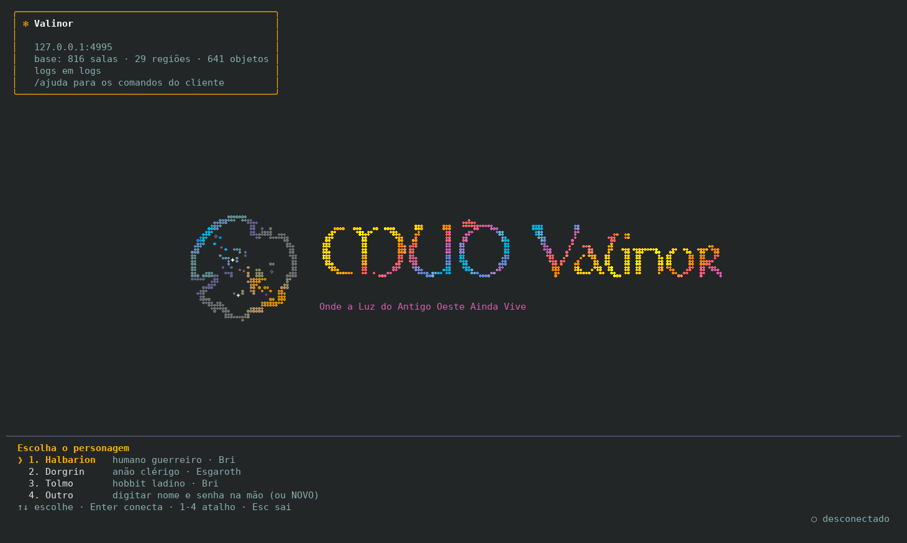
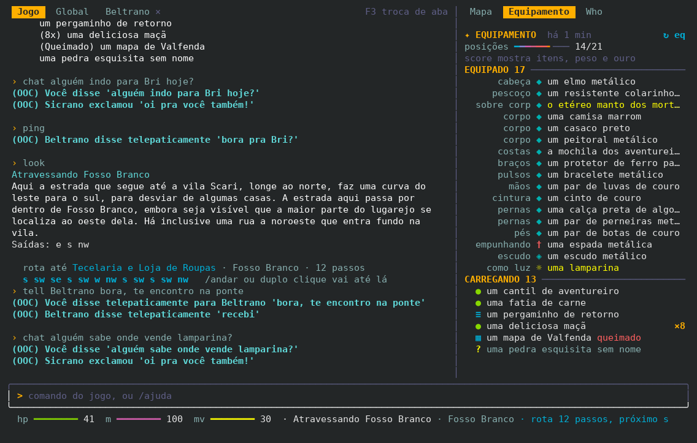
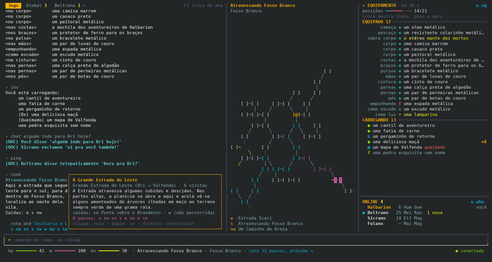
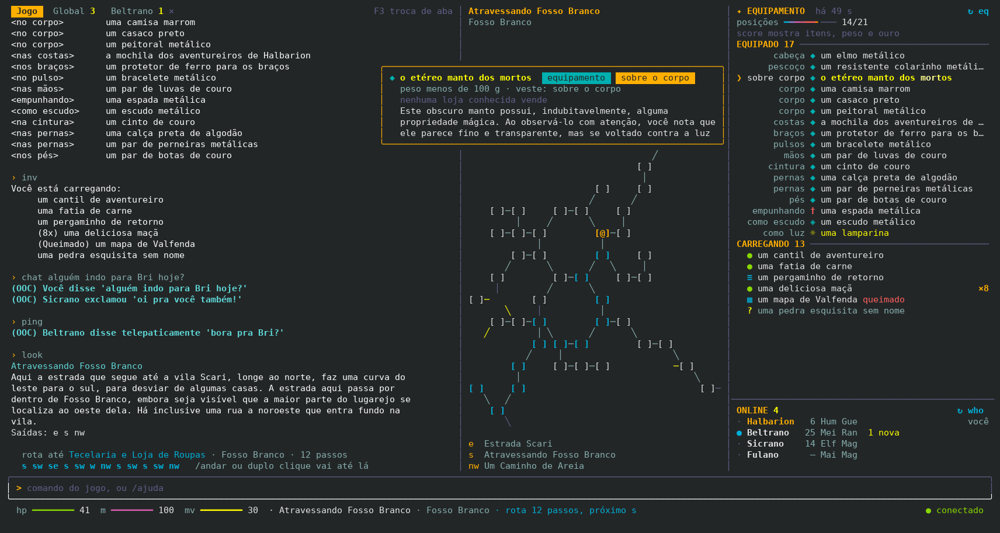
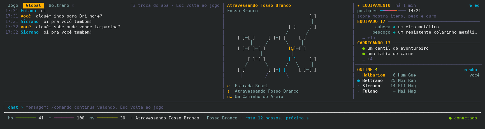
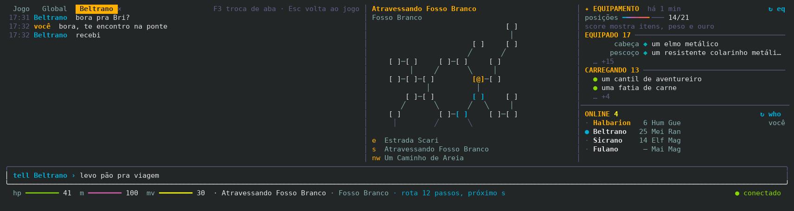
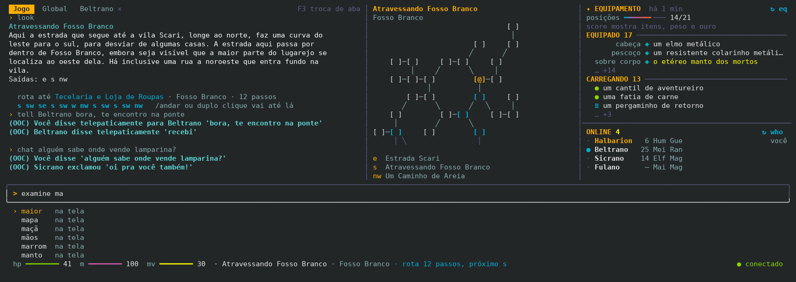
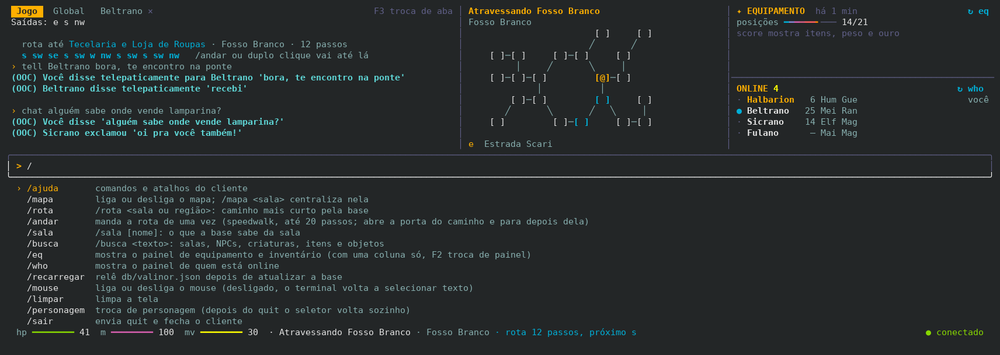

<p align="center"></p>

# Valinor — cliente de terminal (beta)

Cliente de terminal para o MUD Valinor (`mud.valinor.com.br:4000`), inspirado no jeito do
Claude Code: o texto do jogo rola em cima, a caixa de comando fica embaixo e painéis ao lado mostram o **mapa**, o
**equipamento** e **quem está online**, tudo alimentado por uma base de dados do mundo montada jogando.

Feito em Python puro com `curses`. A única dependência é o PyYAML, usado para ler a base.



## Destaques

- **Seletor de personagens** com login automático depois da escolha e logo animado na abertura.
- **Mapa vivo** da base: acha a sala em que você está e desenha as salas em volta. Passar o mouse mostra a prévia, o
  clique traça a rota e o duplo clique vai até lá.
- **Portas**: se a saída está fechada, a direção que você digita leva o `open` junto.
- **Equipamento e inventário** em painel fixo, com o cartão de cada item cruzado com a base: peso, preço, loja e
  descrição.
- **Who e conversa**: lista de quem está online, abas de chat (Global e uma por pessoa) e mensagens não lidas.
- **Autocomplete** de comandos, objetos da sala e palavras da tela, além de sugestão do histórico.
- **Barras de hp, mana e movimento** lidas do prompt, aviso antes do Vazio e keepalive TCP.
- **Cores** tiradas de uma paleta de pôr do sol (`FC-pallete.png`), em 256 cores, com volta ao tema básico em
  terminais de 8/16 cores.
- **Modo leitor de tela**: liga sozinho com NVDA, JAWS, Narrador, Orca, Fenrir ou VoiceOver. O jogo vem em texto
  corrido, sem painéis nem símbolos. O prompt só é lido quando muda. Tell e chat tocam um sino. Mapa e rotas saem
  por extenso.
- **Sem automação**: o cliente só envia o que você digita ou pede (veja [Regras do Valinor](#regras-do-valinor-policy-4)).

## Instalação

Use um terminal com 256 cores e mouse, como Konsole, GNOME Terminal, kitty, iTerm2 ou Windows Terminal.

### Binário

Baixe o arquivo do seu sistema em [Releases](https://github.com/turing-lucas/mud-valinor-client-beta/releases). Ele
já traz o Python, a base do mapa e o logo:

| Sistema | Arquivo |
|---|---|
| Linux x86_64 (Debian 11, Ubuntu 20.04, RHEL 9 ou mais novos) | `valinor-linux-x86_64` |
| macOS com Apple Silicon | `valinor-macos-arm64` |
| macOS com Intel | `valinor-macos-x86_64` |
| Windows 10 ou 11 | `valinor-windows-x86_64.exe` |

Deixe o binário numa pasta sua: o `.credenciais` e a pasta `logs/` ficam ao lado dele.

```bash
chmod +x valinor-linux-x86_64
./valinor-linux-x86_64          # ou: ./valinor-linux-x86_64 <host> <porta>
```

- No macOS, o arquivo baixado vem bloqueado porque não é assinado. Libere com
  `xattr -d com.apple.quarantine valinor-macos-arm64`, ou clique com o botão direito e escolha Abrir.
- No Windows, rode `.\valinor-windows-x86_64.exe` no Windows Terminal.
- `--versao` confere a base e o logo sem abrir a tela.

Os binários de Windows e macOS passam pelos testes e pelo `--versao` no GitHub Actions, mas ainda não foram usados de
verdade nesses sistemas. Se algo não funcionar, abra uma issue.

### Pelo código

Requisitos: Python 3.9 ou mais novo e PyYAML. No Windows, instale também o `windows-curses`.

```bash
git clone https://github.com/turing-lucas/mud-valinor-client-beta.git
cd mud-valinor-client-beta
pip install pyyaml
python3 db/tools/build.py export-json   # gera db/valinor.json, a base que o mapa usa
python3 cliente/valinor.py              # ou: python3 cliente/valinor.py <host> <porta>
```

### Personagens

O seletor lê os personagens de um arquivo `.credenciais` na raiz do projeto, ou na pasta do binário. Cada personagem
é um par `Personagem<X>` / `Senha<X>` com o mesmo sufixo:

```text
Personagem: Fulano
Senha: sua-senha
PersonagemHobbit: Beltrano
SenhaHobbit: outra-senha
```

Proteja o arquivo com `chmod 600 .credenciais`. Ele já está no `.gitignore`. A senha só é lida na hora do login, nunca
aparece na tela e nunca entra no histórico, no autocomplete nem nos logs legíveis. A opção **Outro** do seletor
conecta digitando nome e senha na mão, ou com `NOVO` para criar um personagem.



Se já houver outra conexão aberta nesta máquina (o `mud.sh` ou outro cliente), o seletor avisa e pede confirmação,
porque o Valinor não permite dois personagens online ao mesmo tempo.

## A tela

| Parte | O que mostra |
|---|---|
| Abas no alto | **Jogo**, **Global** e uma aba por pessoa com quem você conversa |
| Texto | a saída do jogo com as cores do servidor; PgUp/PgDn e a roda do mouse rolam |
| Mapa | as salas da base em volta de você, com a sala e a região no título |
| Equipamento | o que você usa e carrega, mais itens, peso e ouro do `score` |
| Who | quem está online, com nível, raça e classe |
| Caixa de comando | o que você digita, com o autocomplete embaixo |
| Barra de status | hp, mana e movimento em barrinhas, sala, região, rota e conexão |

Com 154 colunas ou mais, o cliente mostra três colunas: texto, mapa e equipamento em cima do who. Entre 90 e 153
colunas, fica uma coluna só com abas **Mapa · Equipamento · Who**. F2 ou um clique na aba troca o painel. Com menos de
90 colunas, como no 80×24 padrão, o painel abre por cima do texto com `/mapa`, `/eq`, `/who` ou F2, e Esc volta ao
texto.



### Leitor de tela

O cliente entra sozinho no modo leitor de tela quando acha um leitor de tela ligado:

- NVDA, JAWS ou Narrador no Windows;
- Orca, Fenrir, TDSR ou Speakup no Linux;
- VoiceOver no macOS.

Também dá para forçar: `valinor --leitor` (ou `python3 cliente/valinor.py --leitor`) liga o modo, e `--visual` volta
para a tela com painéis.

O jogo sai em texto corrido, como num telnet: na ordem em que chega, sem cores, molduras, barras ou símbolos. O cursor
fica sempre no fim. Cada linha digitada vai para o jogo. No Linux e no macOS, as setas trazem os comandos anteriores.

O que muda para quem ouve:

- **Prompt calado quando não muda.** Ele é lido quando a vida, a mana ou o movimento mudam. `/status` lê o prompt na
  hora, e `/prompt` faz o cliente ler sempre.
- **Uma linha em branco no máximo** entre as respostas.
- **Sons do Fantasy Chess** para o que acontece antes da fala: seu golpe, golpe que você leva, esquiva, bloqueio,
  morte do bicho (lobo tem uivo próprio), nível novo, item pego ou vestido, porta, comida, bebida, tell, chat, vida
  abaixo de 30% e aviso do Vazio. Tocam pelo sistema (Windows, `afplay` no macOS, `paplay`/`pw-play`/`aplay` no
  Linux); sem nenhum, tell, chat e aviso tocam o sino do terminal. `/som` liga e desliga.
- **Reler sem caçar com o cursor.** `/rever 5` relê as 5 últimas linhas do jogo, e `/conversas` relê as últimas
  conversas.
- **Mapa por extenso.** `/sala` lê a sala atual pela base: região, descrição, saídas com o destino e porta fechada.
- **Rota por extenso.** `/rota taverna` diz o caminho assim: "rota até Taverna Rama Verde, 2 passos: sul, sudeste".
  `/andar` anda até lá e avisa quando você chega.
- **Busca.** `/busca` procura na base.
- **Portas.** Como na tela normal, uma direção com porta fechada manda o `open` antes.
- **Ajuda.** `/ajuda` lista os comandos.

No jogo, `config +aural` faz o Valinor trocar as próprias tabelas e símbolos (o who, por exemplo) por frases.

O seletor de personagem vira uma lista numerada: digite o número e Enter. O login automático, os logs, o keepalive e o
aviso antes do Vazio continuam iguais; o aviso também toca um som. Quando o jogo pede a senha, o que você digita não
aparece na tela. Ctrl+D fecha o cliente; saia do jogo antes com `quit`.

## Mapa e rotas

O mapa reconhece a sala atual pelo título, pela descrição e pelas saídas que o servidor manda, e desenha as salas
vizinhas que a base conhece.

- `@` é você. `[↑]`, `[↓]` e `[↕]` marcam salas com escada. Uma saída em amarelo é uma saída que a base ainda não
  percorreu.
- **Passar o mouse** numa sala mostra a prévia: título, região, descrição, saídas e o caminho até ela (em rosa).
- **Clique** traça a rota (em azul), que também aparece na barra de status.
- **Duplo clique** ou `/andar` manda a rota de uma vez (speedwalk, até 20 passos por vez).
- **Botão direito** centraliza o mapa na sala, e `/mapa` volta para você.
- `/rota <sala ou região>` acha o caminho mais curto; `/sala [nome]` mostra o que a base sabe da sala; `/busca
  <texto>` procura salas, NPCs, criaturas, itens e objetos.



### Portas

Quando a linha `Saídas:` mostra uma saída fechada (`!n`), digitar a direção envia `open n` antes do passo. No
`/andar`, o cliente abre a porta do caminho, atravessa e para do outro lado: se ela estiver trancada, o resto da rota
não sai da sala errada. `/andar` de novo continua. O cliente nunca envia `unlock` e não reage ao texto do servidor.

## Equipamento e inventário

O painel se preenche com a resposta do `eq` e do `inv` que você digita. O botão **↻ eq** (ou F5) envia os dois de uma
vez. O título brilha por alguns segundos quando chegam dados novos. O `score` completa o painel com itens, peso e ouro.

Passar o mouse num item abre o cartão com o que a base sabe dele: categoria, onde fica no corpo, peso, a loja que
vende e por quanto, e a descrição completa.



## Who e conversa

O painel **Online** é preenchido quando você digita `who` ou clica em **↻ who**, nos dois formatos do servidor (tabela
colorida e modo aural). Clicar num nome abre a aba de conversa com a pessoa, sem enviar nada ao jogo.

As linhas de chat continuam no **Jogo** e também vão para uma aba:

- o `(OOC)` de todos vai para a **Global**;
- o `tell` (telepático) e o sussurro de um jogador vão para a aba da pessoa;
- o sussurro de um NPC ("O guarda sussurrou...") fica só no Jogo.

Dentro de uma aba, o Enter envia `chat <texto>` na Global ou `tell <nome> <texto>` na aba da pessoa, e os comandos
com `/` continuam funcionando. Cada aba conta as mensagens não lidas. Um tell que chega com a aba fechada faz um bipe.
F3 passa de uma aba para a outra, Esc com a linha vazia volta ao Jogo e o `×` fecha a aba.





## Autocomplete

As sugestões aparecem sozinhas com `/` ou a partir de duas letras, e com menos letras depois do Tab. As fontes são os
comandos que você mais usa, os objetos e criaturas da sala, as palavras que estão na tela e os comandos do cliente.
A sugestão cinza do histórico é aceita com →.

O autocomplete nunca aprende nem sugere senhas do `.credenciais` ou e-mails. Dentro de uma aba de conversa ele fica
desligado, a não ser que a linha comece com `/`.





## Barra de status e inatividade

- **hp**, **m** e **mv** viram barrinhas lidas do prompt (`<84hp 100m 199mv>`). O máximo vem do `score` ou do maior
  valor já visto. A barra de hp fica amarela na metade, e qualquer barra fica vermelha em um quarto.
- Com um prompt personalizado no jogo, o cliente aprende o formato dele: who, equipamento e mapa continuam
  funcionando, e as barras andam se o prompt tiver um número seguido de `hp`, `m` (ou `mn`) e `mv` (`84hp` ou `84/84hp`), em
  qualquer ordem e com outras coisas no meio. Sem isso as barras ficam paradas e o cliente avisa.
- O cliente conta o tempo sem digitar. Aos 6 minutos, toca um aviso e mostra na barra quanto falta para o Vazio
  (8–10 min) e para o servidor desconectar (cerca de 4 min depois).
- O socket usa keepalive TCP para a conexão não cair à toa. Nenhum comando de jogo é enviado para manter você online.

## Comandos do cliente

| Comando | O que faz |
|---|---|
| `/ajuda` | comandos e atalhos do cliente |
| `/mapa [sala]` | liga ou desliga o mapa; com uma sala, centraliza nela |
| `/rota <sala ou região>` | caminho mais curto pela base |
| `/andar` | manda a rota de uma vez (até 20 passos; abre a porta do caminho e para depois dela) |
| `/sala [nome]` | o que a base sabe da sala |
| `/busca <texto>` | salas, NPCs, criaturas, itens e objetos |
| `/eq` | mostra o painel de equipamento e inventário |
| `/who` | mostra o painel de quem está online |
| `/recarregar` | relê `db/valinor.json` depois de atualizar a base |
| `/mouse` | liga ou desliga o mouse (desligado, o terminal volta a selecionar texto) |
| `/limpar` | limpa a tela |
| `/personagem` | troca de personagem (depois do `quit` o seletor volta sozinho) |
| `/sair` | envia `quit` e fecha o cliente |

## Atalhos

| Tecla | Ação |
|---|---|
| Enter | envia o comando (numa aba de conversa, envia a mensagem) |
| Tab | completa; com a lista aberta, aceita a sugestão |
| → no fim da linha | aceita a sugestão cinza do histórico |
| ↑ / ↓ | histórico de comandos, ou navega na lista de sugestões |
| PgUp / PgDn, roda do mouse | rola o texto |
| F2 | troca o painel quando há uma coluna só |
| F3 | próxima aba de conversa |
| F5 | envia `eq` e `inv` |
| Esc | fecha a lista; com a linha vazia, sai da aba de conversa ou fecha o painel que cobre o texto |
| Ctrl-A / Ctrl-E | início / fim da linha |
| Ctrl-U / Ctrl-W | apaga até o início / a palavra anterior |
| Ctrl-L | redesenha a tela |
| Ctrl-C | limpa a linha; duas vezes seguidas, envia `quit` e sai |
| Shift + arrastar | seleciona texto com o mouse ligado |

## Regras do Valinor (POLICY 4)

O Valinor proíbe automação de personagens: bots, gatilhos e qualquer coisa que envie comandos sem a intervenção
direta do jogador. O cliente segue essa regra:

- envia só o que você digita, os botões que você clica e os atalhos que você aperta. O ↻ eq, o ↻ who, o `/andar` e o
  `open` antes de uma porta funcionam como aliases seus;
- não tem gatilhos: nenhum texto do servidor dispara um comando;
- não envia nada para evitar o Vazio, não reconecta sozinho e não refaz o login sem você escolher o personagem;
- avisa quando já existe outra conexão aberta nesta máquina.

## Cores

As cores do cliente vêm da `FC-pallete.png` (`cliente/paleta.py`): laranja e vermelho do céu, azul da casa, lilás e a
calçada molhada. As cores que o servidor manda são remapeadas para a mesma paleta. Em terminais de 8/16 cores, o
cliente usa o tema básico do terminal.

Se o jogo chegar sem cores, o personagem provavelmente está em modo aural. Digite `config -aural` no jogo. O cliente
entende os dois formatos de prompt e de who.

## Logs

O cliente grava tudo em `logs/` (fora do git):

- `logs/raw.log` — os bytes do servidor, a fonte da base de dados;
- `logs/transcript.log` — a sessão legível, sem as senhas;
- `logs/chat.log` — só as linhas de conversa.

No binário, `logs/` fica na pasta do executável. Para testes, `VALINOR_LOGS=<pasta>` grava em outra pasta e `VALINOR_CRED=<arquivo>` lê outro arquivo de personagens.

## A base de dados

O mapa, as rotas, o cartão dos itens e a busca usam a base em `db/`, montada a partir do que foi visto jogando:
816 salas, 29 regiões, 641 objetos, 897 textos, além de NPCs, criaturas, itens, lojas, mecânicas e lore.

- `db/data/*.yaml` — a fonte da verdade, editável;
- `db/tools/minerar.py` — extrai salas e textos do `logs/raw.log` para os YAML;
- `db/tools/build.py` — `validate`, `export-json` (gera `db/valinor.json`) e `sqlite` (gera `db/valinor.sqlite`);
- `catalogo.md` e `notas.md` — o catálogo do mundo e as anotações das sessões.

Depois de jogar e atualizar a base, `/recarregar` relê o `db/valinor.json` sem reiniciar o cliente.

## Estrutura

| Arquivo | Papel |
|---|---|
| `cliente/valinor.py` | o aplicativo: tela, teclado, conexão e comandos |
| `cliente/conexao.py` | telnet, personagens do `.credenciais` e caminho dos logs |
| `cliente/mapa.py` | acha a sala na base, desenha o minimapa e calcula rotas |
| `cliente/painel.py` | painéis da direita, mouse, `/rota`, `/andar`, portas e barra de status |
| `cliente/mochila.py` | painel de equipamento e inventário e cartão dos itens |
| `cliente/conversa.py` | abas de conversa e painel do who |
| `cliente/completar.py` | autocomplete |
| `cliente/vigia.py` | aviso de inatividade e keepalive TCP |
| `cliente/logo.py`, `logo.txt` | logo em braille e animação da abertura |
| `cliente/paleta.py` | cores da `FC-pallete.png` |

## Testes

```bash
python3 cliente/test_cliente.py
python3 db/tools/test_build.py
```

## Gerar os binários

O workflow `.github/workflows/binarios.yml` gera os quatro binários com o PyInstaller no GitHub Actions. Ele roda à
mão (Actions › binarios › Run workflow) ou numa tag `v*`, que também publica os arquivos numa Release. O de Linux é
gerado num Debian 11 para rodar em qualquer distribuição com glibc 2.31 ou mais nova.

Para gerar só o do seu sistema:

```bash
pip install pyyaml pyinstaller
python3 db/tools/build.py export-json
pyinstaller --onefile --name valinor --paths db/tools \
  --add-data "db/valinor.json:db" --add-data "cliente/logo.txt:." cliente/valinor.py
./dist/valinor --versao
```

## Licença

[MIT](LICENSE).
